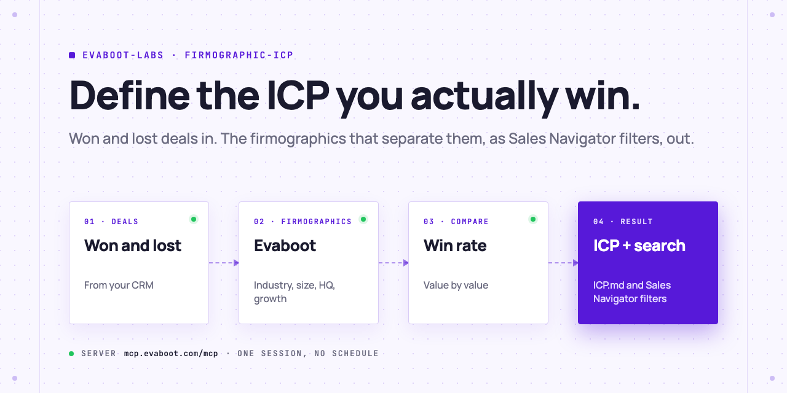
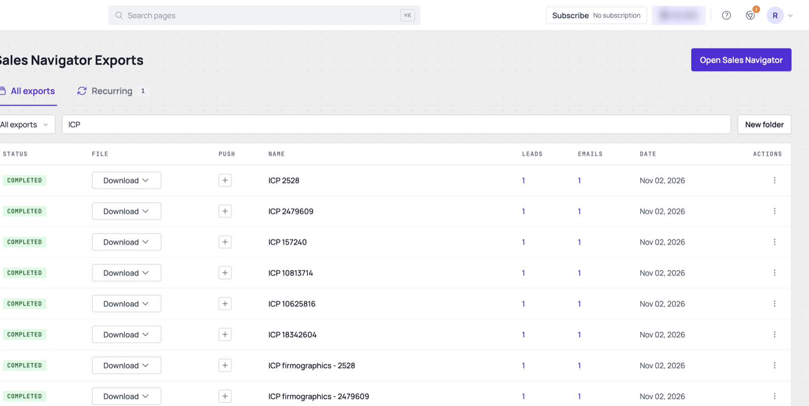
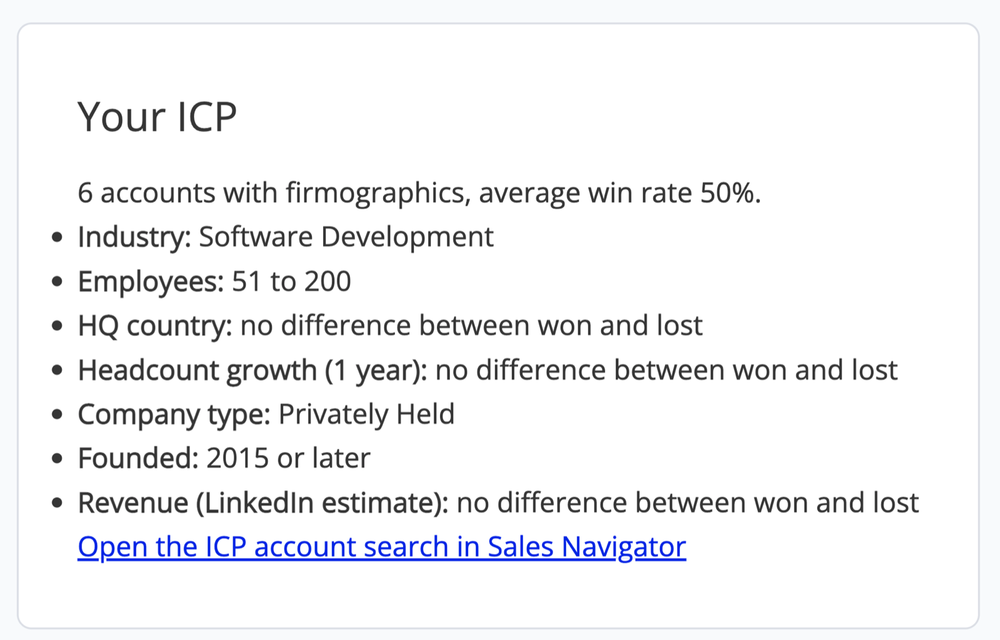
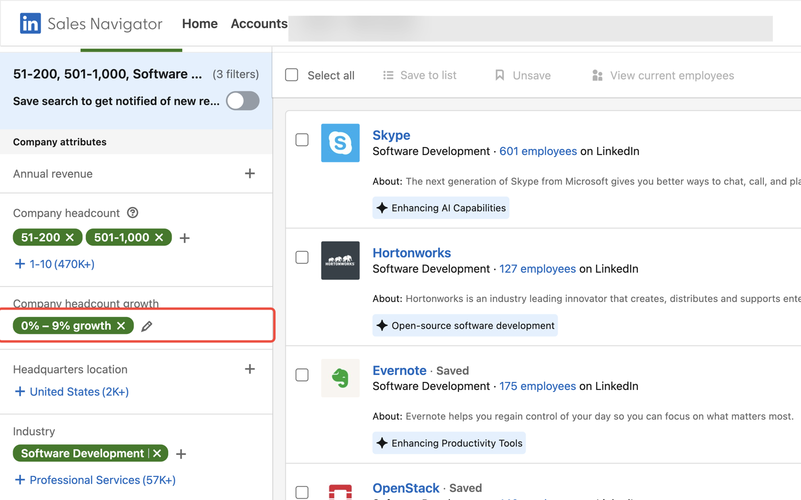

<picture>
  <source media="(prefers-color-scheme: dark)" srcset=".github/assets/banner-dark.png">
  
</picture>

# Firmographic ICP

Give your AI Agent the deals you won and the deals you lost. It reads each company's firmographics through Evaboot (industry, headcount, headquarters, growth, type, founding year, revenue), finds the values that win more often than average, writes your ideal customer profile to `ICP.md`, and turns it into a LinkedIn Sales Navigator account search.

[](AGENTS.md)
[](https://evaboot.com/mcp)
[](LICENSE)

## Set it up in one prompt

Paste this into Claude Code, Codex or Cursor:

```text
Clone https://github.com/evaboot-labs/firmographic-icp, read AGENTS.md and follow the skill. Define my ICP from the deals I won and lost this year.
```

<details>
<summary>Or install the skill</summary>

Claude Code:

```text
/plugin marketplace add evaboot-labs/firmographic-icp
/plugin install firmographic-icp@evaboot-labs-firmographic-icp
```

Codex, Cursor and other agents:

```bash
npx skills add evaboot-labs/firmographic-icp
```

</details>

## How it works

**1. One Evaboot row per account.** For each won and lost company, Evaboot exports one row from Sales Navigator, which carries all the company's firmographics.



**2. A win rate per value.** A value joins your ICP when it wins more often than average, with at least 2 wins.



**3. A Sales Navigator account search.** Industry, headcount, headquarters and growth become account filters.



## What you need

- An [Evaboot account](https://dash.evaboot.com/accounts/signup/?last_click_origin=firmographic-icp-repo) and a Sales Navigator seat.
- Python 3 for `icp.py`. No packages.
- Your won and lost deals: 20 of each gives a real signal, 3 of each is the minimum.
- Cost: 1 Evaboot credit per account.

## Go further

| Page | For |
|---|---|
| [ACCOUNTS.md](ACCOUNTS.md) | Your won and lost accounts |
| [docs/accounts.md](docs/accounts.md) | Which deals to list and what the comparison reads |
| [docs/connect-your-agent.md](docs/connect-your-agent.md) | The Evaboot MCP server, by hand, for each agent |
| [docs/n8n.md](docs/n8n.md) | The same ICP from an n8n form |

---

Agents: start at [AGENTS.md](AGENTS.md) · Built by [Evaboot](https://evaboot.com) · More workflows at [github.com/evaboot-labs](https://github.com/evaboot-labs) · [MIT license](LICENSE)
